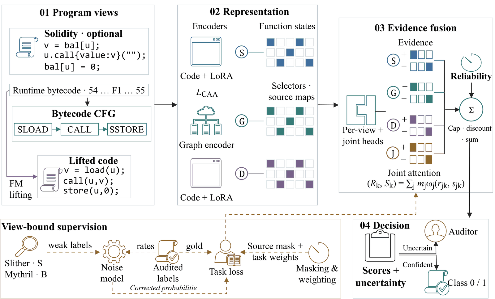
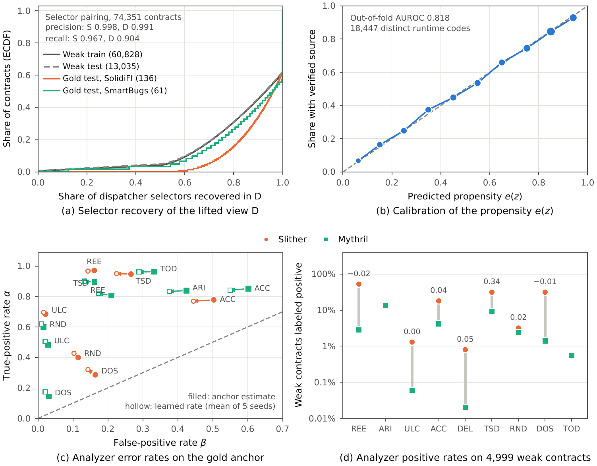
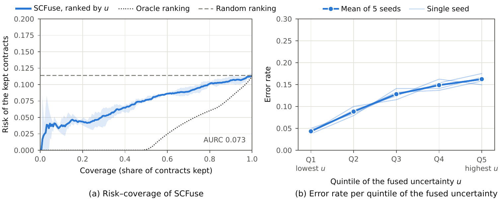
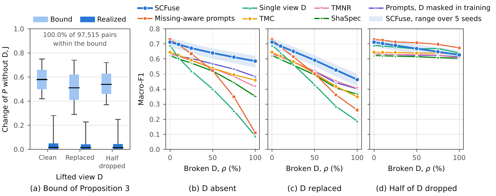

<div align="center">

# SCFuse

### Compiler-anchored evidential fusion of low-quality foundation-model program views for smart-contract vulnerability detection

Tuan-Dung Tran, Hai Tran, Bao Huynh, Van-Hau Pham

University of Information Technology, Ho Chi Minh City, Vietnam<br>
Vietnam National University Ho Chi Minh City, Ho Chi Minh City, Vietnam

[](https://www.python.org/)
[](https://pytorch.org/)
[](LICENSE)

</div>

SCFuse is the reference implementation of the paper above. It detects nine classes of code-level weaknesses in
Ethereum smart contracts by fusing three program views of each contract, each unreliable in its own way:

- **S**, the verified Solidity source, published for only part of the deployed contracts;
- **G**, the control-flow graph recovered from the runtime bytecode, always available;
- **D**, pseudo-Solidity lifted from the bytecode by a code foundation model (Qwen2.5-Coder-7B-Instruct), fluent but
  possibly wrong, and missing when lifting fails.

Every defect of these views leaves a trace that the analysis pipeline already measures. SCFuse consumes these traces as
supervision and as quality evidence instead of learning around them: compiler source maps and function selectors
supervise the alignment of the views, measured descriptors such as round-trip recompilation fidelity decide how much
evidence each view may contribute, and the input view of each static analyzer decides when its labels are used.

## Contents

- [Method](#method)
- [Benchmark](#benchmark)
- [Repository structure](#repository-structure)
- [Installation](#installation)
- [Data](#data)
- [Quick start](#quick-start)
- [Reproducing the paper](#reproducing-the-paper)
- [Configuration](#configuration)
- [License](#license)

## Method

<p align="center">
  
</p>
<p align="center"><em>Figure 1 of the paper. Available views are encoded at function granularity; per-view and joint
heads emit capped evidence that is gated by availability, discounted by a learned reliability and pooled into class
probabilities and uncertainties. Analyzer labels are corrected by view-bound transitions anchored on audited labels.</em></p>

Each component targets one defect of smart-contract data:

| Defect | Observable trace | Mechanism (paper section) | Implementation |
|---|---|---|---|
| **D1** Structured missingness | Bytecode covariates predict whether source is published | Absent views add no evidence; source masking drawn from a propensity e(z) and density-ratio weights w(z) (§4.3, §4.5) | [`prep/propensity.py`](scfuse/prep/propensity.py), [`data.py`](scfuse/data.py), [`train.py`](scfuse/train.py) |
| **D2** Partial correspondence | Function selectors and compiler source maps | Multi-positive contrastive alignment over function and block–span anchors (§4.2) | [`prep/source.py`](scfuse/prep/source.py), [`model/losses.py`](scfuse/model/losses.py) |
| **D3** Heterogeneous quality | Unresolved jumps, round-trip fidelity, selector agreement | Capped evidence, descriptor-conditioned reliability discounts, dissonance-aware deferral (§4.3) | [`prep/lifted.py`](scfuse/prep/lifted.py), [`model/scfuse.py`](scfuse/model/scfuse.py), [`model/fusion.py`](scfuse/model/fusion.py) |
| **D4** Weak, incomplete labels | Input view of each analyzer, audited anchors | View-bound forward correction with anchored noise priors (§4.4) | [`model/losses.py`](scfuse/model/losses.py), [`train.py`](scfuse/train.py) |

**Reliability-discounted evidential fusion.** Each evidence source
$j \in \lbrace \mathsf{S}, \mathsf{G}, \mathsf{D}, \mathsf{J} \rbrace$, where $\mathsf{J}$ is a joint source that reads
all available views, emits support and opposition evidence $(r_{jk}, s_{jk}) \in [0, E_{\max}]^2$ for class $k$. With
availability $m_j$, a reliability $\omega_j$ predicted from the quality descriptors of the source, a base rate $a_k$
and a prior weight $W$, the fused probability and uncertainty are (Eq. 18)

$$
P_k = \frac{a_k W + \sum_j m_j \omega_j r_{jk}}{W + \sum_j m_j \omega_j (r_{jk} + s_{jk})},
\qquad
u_k = \frac{W}{W + \sum_j m_j \omega_j (r_{jk} + s_{jk})}.
$$

A missing view therefore contributes exactly zero evidence (Proposition 1), and a closed-form interval bounds the fused
probability under any input to a given view (Proposition 3). [`model/certify.py`](scfuse/model/certify.py) evaluates
this certificate for every prediction, and [`tests/test_fusion.py`](tests/test_fusion.py) checks both properties.
SCFuse-R (§4.7) also feeds selector precision and coverage to the reliability of D and the descriptors of every view to
that of J, and is trained with corrupted lifts.

## Benchmark

The clone-aware benchmark pairs source, CFG and lifted views of every contract over nine weakness classes. The four
defects are visible in the data before training:

<p align="center">
  
</p>
<p align="center"><em>Figure 3 of the paper. (a) Share of the dispatcher selectors that the lifted view D recovers.
(b) Out-of-fold calibration of the verification propensity e(z). (c) True- and false-positive rates of Slither and
Mythril on the gold anchor (filled) and learned by SCFuse (hollow). (d) Positive rates of the two analyzers on the same
weak contracts, with Cohen's κ.</em></p>

The fused uncertainty separates confident from uncertain contracts:

<p align="center">
  
</p>
<p align="center"><em>Figure 5 of the paper. Fused uncertainty of SCFuse under P1: (a) risk–coverage curve when contracts
are kept in order of increasing uncertainty u, with the oracle and random orderings; (b) error rate per quintile of
u.</em></p>

Reliability-discounted fusion bounds the influence of the lifted view and degrades gracefully as more lifts break:

<p align="center">
  
</p>
<p align="center"><em>Figure 6 of the paper. (a) Bound of Proposition 3 with Q = {D, J} and the realized change of the
fused probability for a clean, replaced or half-dropped D. (b–d) P6: macro-F1 against the share ρ of test contracts
whose D is absent, replaced by another contract's, or reduced to half of its functions.</em></p>

## Repository structure

```text
scfuse/                 Python package
├── prep/               data preparation: contract index, views S and A (solc), G (CFG recovery),
│                       D (lifting, round-trip fidelity), leakage guard, analyzer labels, propensity,
│                       packing, frozen features, opcode pretraining, P5′ mutations
├── model/              encoders, fusion operator (Eqs. 18 and 20), certificates (Prop. 3), losses,
│                       re-implemented baseline heads
├── utils/              EVM disassembly and CFG recovery, solc driver, Solidity scanner, AST vocabulary
├── report/             LaTeX tables and PDF figures generated from results/
├── train.py            training objective and loop (§4.6)
├── eval.py             gold-test evaluation under P1–P6: metrics, diagnostics, certificates, deferral
├── protocols.py        view transformations of P2–P6
├── external.py         external audited cohort (P8)
├── stats.py            paired bootstrap with Holm correction
├── sanity.py           memorization checks (Table 5)
├── llm.py              zero-shot LLM baseline
├── seeds.py            spread of the validation macro-F1 over seeds
└── data.py, config.py, labels.py, metrics.py, schema.py
configs/                experiment configurations (see Configuration)
scripts/slurm/          Slurm templates: training (one seed or a five-seed array) and any module
tests/                  unit tests: fusion properties, losses, bytecode and Solidity utilities
data/splits/            frozen split identifiers (released upon publication)
docs/                   reproduction guide and figures
```

## Installation

SCFuse needs Python 3.12 and a CUDA GPU for training, lifting and feature extraction. The unit tests run on CPU.

```bash
git clone https://github.com/b1endong/scfuse.git
cd scfuse
conda create -n scfuse python=3.12 -y
conda activate scfuse
pip install -r requirements.txt     # the PyTorch 2.4.0 wheels for Linux bundle CUDA 12.1
pytest -q
```

Rebuilding the data also needs the compilers and the two static analyzers. SCFuse calls them as command-line tools,
and Slither and Mythril pin incompatible dependencies, so each is installed in its own environment:

```bash
pipx install solc-select==1.2.0
pipx install slither-analyzer==0.11.6
pipx install mythril==0.24.8
solc-select install all              # solc binaries used for recompilation and by Slither
```

The lifter and the LoRA regime download `Qwen/Qwen2.5-Coder-7B-Instruct` and `microsoft/unixcoder-base` from Hugging
Face. On clusters whose compute nodes have no internet access, download both once on a login node.

## Data

The benchmark is built from public sources: verified Ethereum contracts from
[Smart Contract Sanctuary](https://github.com/tintinweb/smart-contract-sanctuary) (labeled by Slither and Mythril),
[SmartBugs Curated](https://github.com/smartbugs/smartbugs-curated) and
[SolidiFI](https://github.com/DependableSystemsLab/SolidiFI-benchmark) (audited labels),
[DAppSCAN](https://github.com/InPlusLab/DAppSCAN) (external audit test) and a deployment sample drawn with
[Ethereum ETL](https://github.com/blockchain-etl/ethereum-etl). Weak contracts are deduplicated into clusters of exact
and near duplicates, clusters never cross splits, and weak contracts that duplicate a gold contract are removed.

As stated in the paper, the split identifiers (`data/splits/`), the remaining benchmark-construction scripts and the
trained checkpoints will be released in this repository upon publication. All third-party datasets remain subject to
their respective licenses. [docs/REPRODUCING.md](docs/REPRODUCING.md#1-inputs) lists the inputs that the preparation
scripts expect.

## Reproducing the paper

[docs/REPRODUCING.md](docs/REPRODUCING.md) gives every step from the raw inputs to the tables and figures. Each
experiment maps to configurations and commands as follows:

| Paper | Configurations and commands |
|---|---|
| Table 4, Fig. 3 (benchmark and its low-quality traits) | `scfuse.prep.traits`, `scfuse.report` |
| Table 5 (memorization checks) | `scfuse.sanity` |
| Table 7, Fig. 5 (main comparison, P1–P5′) | [`default.yaml`](configs/default.yaml), [`scfuse_r.yaml`](configs/scfuse_r.yaml), [`baselines/`](configs/baselines); `scfuse.eval --analyzers`, `scfuse.llm`, `scfuse.stats` |
| Table 8 (reliability diagnostics) | `scfuse.eval` of SCFuse and SCFuse-R |
| Table 9 (ablations) | [`ablations/`](configs/ablations) |
| Table 10 (weak supervision, P7) | [`weak/`](configs/weak) |
| Fig. 6 (bound of Proposition 3, P6) | `scfuse.eval` |
| Tables 11–13 (external audit test, P8) | `scfuse.external` |

The evaluation protocols:

| Protocol | Condition | Code |
|---|---|---|
| P1 | Full views | `scfuse.eval --protocols P1` |
| P2 | On-chain missingness: source removed with probability 1 − e(z) | `P2` |
| P3 | Random missingness at the rate of P2 (control of P2) | `P3` |
| P4 | Bytecode only: source removed from every contract | `P4` |
| P5 | Lift replaced by another contract's or cut to half of its functions; selector-gated control | `P5_replaced`, `P5_half`, `P5_gate` |
| P5′ | Selector-preserving semantic mutation of one lifted function | `P5prime` |
| P6 | Share ρ of broken lifts (absent, replaced or halved) | `P6` |
| P7 | Weak supervision with 56 or 12 audited anchors | [`configs/weak/`](configs/weak) |
| P8 | External audited DAppSCAN cohort, bytecode only | `scfuse.external` |

`python -m scfuse.report` regenerates the LaTeX tables and PDF figures from `results/` alone; a missing result is
printed as `--`, and no value is typed by hand.

## License

The code is released under the [MIT License](LICENSE). Third-party datasets and models keep their own licenses.
